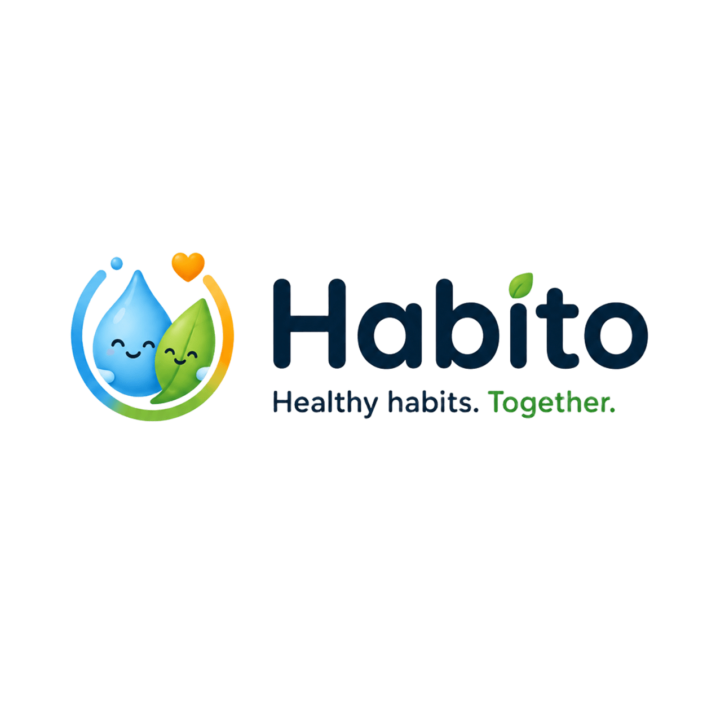
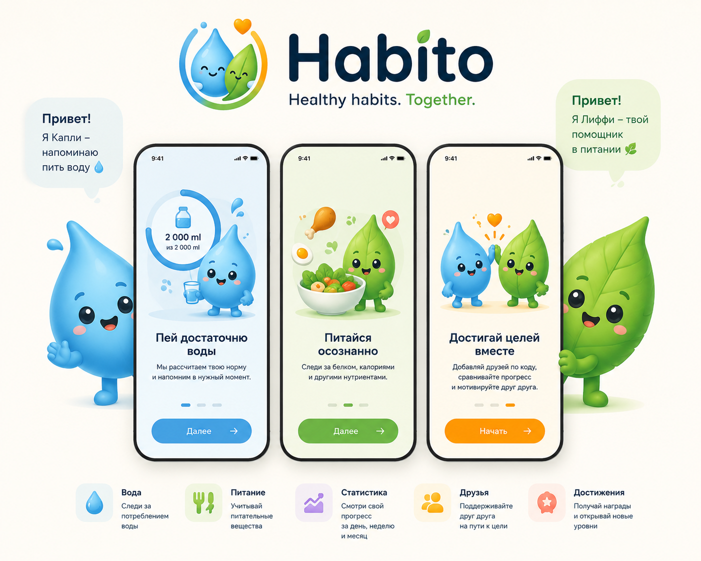
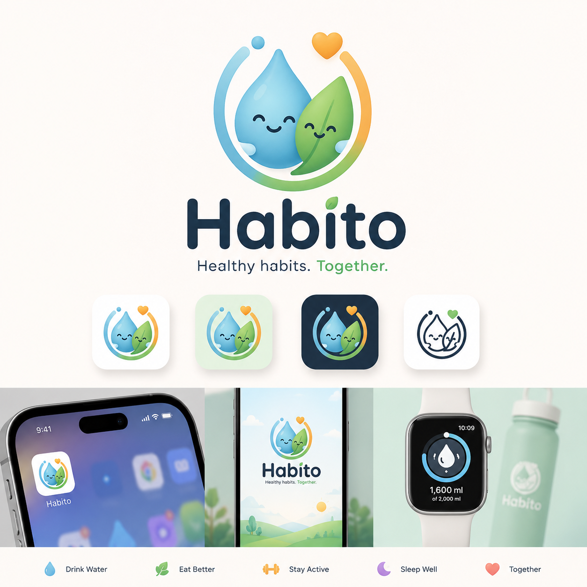

<p align="center">
  
</p>

# Habito

**Здоровые привычки. Вместе.** Мобильное PWA-приложение для контроля воды,
питания и основных показателей здоровья — не медицинский инструмент, а
дружелюбный ежедневный помощник в мультяшном стиле.

## Идея

Большинство трекеров — одинокая рутина: вносишь воду и калории, смотришь на
цифры, бросаешь через неделю. Habito строится вокруг другого принципа —
**привычки держатся на поддержке**:

- 💧 **Вода** — персональная дневная норма, умное расписание напоминаний по
  твоему режиму сна и уже выпитому, отметка одним тапом;
- 🥗 **Питание** — учёт белка, калорий и нутриентов по базе продуктов (после
  MVP — распознавание еды по фото с обязательным подтверждением);
- 📊 **Статистика** — понятный прогресс за день, неделю и месяц, серии
  успешных дней, история веса;
- 🤝 **Друзья** — добавление по коду, совместные цели и сравнение прогресса
  **в процентах от личных норм**, а не в абсолютных цифрах: два литра одного —
  не то же, что два литра другого;
- 🔒 **Приватность по умолчанию** — друг видит только то, что ты явно открыл;
  точный вес и список еды скрыты изначально.

Пользователя сопровождают маскоты — **Капли** 💧 (помощник по воде) и
**Лиффи** 🌿 (помощник по питанию): радуются выполненной норме, поддерживают
после пропущенного дня и никогда не ругают.

<p align="center">
  
</p>

## Как это выглядит

Бренд и иконки приложения:

<p align="center">
  
</p>

Дизайн-направление **Habito Play** — Nintendo-like / modern cartoon: «чанки»-плашки
с плотной тенью, крупные цифры, тёплая палитра, маскот-компаньон в углу экрана:

<p align="center">
  
</p>

Продуктовый план целиком — [plan.md](plan.md), архитектурные правила —
[конституция](docs/constitution.md), техническая документация для
агентов и разработчиков — [CLAUDE.md](CLAUDE.md).

**Текущее состояние**: walking skeleton — каркас (монорепо, web, api, хранилища,
CI-гейты) работает end-to-end, бизнес-логики ещё нет.

## Стек

Bun-монорепо: `apps/web` (Nuxt 4.5, SSR, nitro-bun) + `apps/api` (Elysia) +
PostgreSQL 17 + Redis 8. Контракт API — OpenAPI, из которого генерируется
типизированный SDK для web.

## Предварительные требования

- [Docker](https://docs.docker.com/get-docker/) с Compose v2 (запущенный демон)
- [Bun](https://bun.sh) 1.x
- Git

## Запуск

### Полный стек одной командой (production-like)

```bash
git clone <repo> habito && cd habito
cp .env.example .env
docker compose up --build -d
```

Проверка:

- http://localhost:3000 — страница приложения (показывает состояние системы);
- http://localhost:3333/health — состояние API и зависимостей (JSON);
- http://localhost:3333/openapi — интерактивная документация API;
- `docker compose ps` — все 4 сервиса в статусе healthy.

### Режим разработки (hot-reload)

```bash
bun install
bun dev            # postgres+redis в Docker, api (:3333) + web (:3000) на хосте
bun dev api        # только api (+ хранилища)
bun dev web        # только web
bun dev --no-test  # пропустить pre-flight тесты
```

`bun dev` сам проверяет Docker, свежесть зависимостей, прогоняет тесты,
освобождает порты 3000/3333, ждёт готовности хранилищ и генерирует SDK.

## Команды качества

```bash
bun run lint        # ESLint + Prettier (check)
bun run format      # Prettier (write)
bun run typecheck   # tsc (api) + vue-tsc (web)
bun run test        # bun test (api) + vitest (web)
bun run gen:api     # экспорт OpenAPI из api + генерация SDK в web
bun run db:generate # Prisma client
```

Те же проверки выполняет CI на каждый PR ([.github/workflows/ci.yaml](.github/workflows/ci.yaml));
установка зависимостей везде — `bun install --frozen-lockfile`.

## Troubleshooting

- **Занят порт 5432 или 6379** (другой проект на машине): поменяйте
  `POSTGRES_PORT`/`REDIS_PORT` в `.env` и синхронно хост-порт в
  `DATABASE_URL`/`REDIS_URL`. Внутри compose-сети конфликтов не бывает.
- **Занят порт 3000/3333**: `bun dev` освобождает их автоматически; для
  compose-режима остановите занимающий процесс.
- **Отсутствует переменная окружения**: api при старте перечислит недостающие
  переменные и подскажет `cp .env.example .env`.
- **`bun install --frozen-lockfile` падает**: lock-файл разошёлся с
  `package.json` — выполните `bun install` и закоммитьте обновлённый `bun.lock`.
- **Проверить деградацию**: `docker compose stop redis` → `/health` отвечает 503
  с `"cache":"down"`; `docker compose start redis` — восстановится само.

## Для мейнтейнера: branch protection

После создания репозитория на GitHub включите обязательные проверки для `main`:

```bash
# имена чеков matrix-job — «images (api)» и «images (web)», не «images»
gh api repos/TheMaksKryt/habito/branches/main/protection -X PUT \
  -H "Accept: application/vnd.github+json" \
  --input - <<'JSON'
{
  "required_status_checks": {
    "strict": true,
    "contexts": ["quality", "images (api)", "images (web)"]
  },
  "enforce_admins": true,
  "required_pull_request_reviews": null,
  "restrictions": null
}
JSON
```

Либо через веб: Settings → Branches → Add branch protection rule → `main` →
Require status checks: `quality`, `images (api)`, `images (web)`.

## Структура

```text
apps/web       Nuxt 4.5 (SSR, PWA в будущем)
apps/api       Elysia + Prisma + ioredis
packages/      будущие общие пакеты
scripts/dev.ts dev-оркестратор (bun dev)
docs/          конституция и дизайн-решения
specs/         архив артефактов walking skeleton (spec → plan → tasks)
```

Агентный харнес — [ECC](https://github.com/affaan-m/ECC): плагин `ecc@ecc`
включён для репозитория через `.claude/settings.json` (marketplace подхватится
автоматически). Рабочий процесс фич: `/plan` → реализация через TDD →
`/code-review` (см. конституцию, раздел «Рабочий процесс»).
